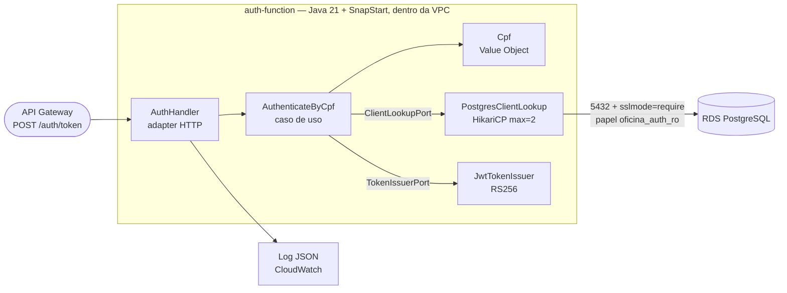

# oficina-auth-lambda

Função serverless de autenticação por CPF (AWS Lambda, **Java 21 + SnapStart**) e, na etapa E6, o API
Gateway HTTP API com o Lambda authorizer — Tech Challenge FIAP, Fase 3.

Repositórios irmãos: [oficina-app](https://github.com/victor-duarte-mendonca/oficina-app),
[oficina-infra-k8s](https://github.com/victor-duarte-mendonca/oficina-infra-k8s),
[oficina-infra-database](https://github.com/victor-duarte-mendonca/oficina-infra-database).

## O que a função faz

`POST /auth/token` com `{"cpf": "529.982.247-25"}` (com ou sem máscara) devolve um JWT que a aplicação
aceita nas rotas `/me/*`:

| Status | Corpo | Quando |
|---|---|---|
| 200 | `{"access_token","token_type":"Bearer","expires_in":3600,"client":{"id","name"}}` | CPF válido, cliente existe e está `ACTIVE` |
| 400 | `{"error":"invalid_request","message":"CPF inválido"}` | CPF ausente, malformado, dígito verificador errado ou sequência repetida |
| 401 | `{"error":"unauthorized","message":"Não foi possível autenticar com os dados informados"}` | Cliente inexistente **ou** `INACTIVE` **ou** `BLOCKED` |
| 500 | `{"error":"internal_error","correlationId":"..."}` | Falha de banco ou de assinatura |

**401 idêntico para os três casos** (byte a byte): o CPF é o único fator, e responder 404 para
inexistente transformaria o endpoint num validador de "este CPF é cliente da oficina?". O motivo
(`not_found`/`inactive`/`blocked`) existe só no log estruturado.

Claims do token: `iss=oficina-api`, `sub`/`upn`=id do cliente, `groups=["CLIENT"]`, `clientId`, `cpf`
**mascarado** (`529******25`), `jti`, `iat`, `exp` (1 h). Assinado com **RS256 e a mesma chave privada da
aplicação**, então ela o valida sem configuração nova (verificado: a aplicação aceita um token emitido por
esta função; adulterado, recusa).

## Arquitetura



Hexagonal enxuta: `domain` (CPF, cliente), `application` (caso de uso e portas) e `infrastructure`
(handler, JDBC, JWT, config). **Sem framework** — Quarkus/Spring numa função destas é peso morto de cold
start e de superfície de CVE.

## Authorizer do gateway (`authorizer-function`, E6)

Segunda função do repositório: o **Lambda authorizer** do API Gateway (`REQUEST`, *simple response*,
`identitySource = $request.header.Authorization`, cache de 300 s). Valida o JWT **antes** de a requisição
chegar ao cluster: token ausente, malformado, expirado ou forjado **nunca alcança a EC2**.

| | `auth-function` | `authorizer-function` |
|---|---|---|
| Papel | emite o token a partir do CPF | confere o token em cada requisição não cacheada |
| Rede | **dentro** da VPC (alcança o RDS) | **fora** da VPC: sem ENI, sem cold start de VPC no caminho |
| Segredos | senha do banco, chave **privada** | **nenhum**: só a chave **pública** |
| Banco | `oficina_auth_ro` (somente leitura) | **não tem driver JDBC nem credencial** |

Por que fora da VPC e sem banco: se o authorizer falhar, **todas** as rotas protegidas param. O conjunto
de coisas que podem quebrá-lo precisa ser mínimo, e dois níveis de privilégio pedem dois perfis de rede.

**O que verifica** (nesta ordem; qualquer falha recusa): cabeçalho `Authorization: Bearer <jwt>` →
algoritmo **fixado em RS256** → assinatura com a chave pública → `iss` → `exp` (com tolerância de relógio de
30 s; sem `exp` o token é recusado) → `nbf` → `sub` → **algum papel conhecido** em `groups`
(`ADMIN`, `MECHANIC` ou `CLIENT`). Quem decide *o que* cada papel pode fazer é a aplicação
(`@RolesAllowed`); nenhuma das duas camadas confia na outra.

**Ataques cobertos por teste:** `alg: none`, **confusão de algoritmo** (HS256 usando a chave pública como
segredo), troca de algoritmo (RS384/RS512/PS256 com a chave certa), `jwk` embutido no header, `crit`
desconhecido, payload adulterado, assinatura truncada, expirado, `nbf` futuro, emissor errado, sem
`sub`/`exp`, e lixo.

**Falha fechada:** nunca lança; qualquer erro inesperado vira `{"isAuthorized": false}`. A recusa não leva
detalhe ao chamador; o motivo (`bad_signature`, `expired`, …) existe só no log. O token **nunca** vai para o
log.

| Variável | Obrigatória | Origem |
|---|---|---|
| `JWT_PUBLIC_KEY_PEM` | sim | derivada da chave privada pelo Terraform (`tls_public_key`); não é segredo |
| `JWT_ISSUER` | não (`oficina-api`) | |
| `CLOCK_SKEW_SECONDS` | não (30) | |

## Decisões de segurança

- Papel do banco **somente-leitura em 5 colunas** (`oficina_auth_ro`): sem `INSERT`/`UPDATE`/`DELETE` e
  sem ler e-mail nem telefone — provado por teste contra PostgreSQL real.
- A consulta ocorre **antes** de qualquer recusa de autenticação: "não existe", "inativo" e "bloqueado"
  fazem o mesmo trabalho, para o tempo de resposta não distinguir os casos.
- **Nunca** vai para o log: CPF completo, token emitido, mensagem do driver (pode conter host/banco) nem
  stack trace. Só o tipo da exceção e o `SQLState`.
- Segredos só em variáveis de ambiente (sem Secrets Manager: sem NAT as APIs públicas não são
  alcançáveis); chave privada só em memória, nada em `/tmp`.
- `Cache-Control: no-store` nas respostas (o corpo carrega um token).

## SnapStart

O pool JDBC **não** é aberto na inicialização: o socket morreria na restauração do snapshot. Ele é criado
sob demanda no primeiro atendimento. Antes do checkpoint, um hook aquece o caminho de CPF e de assinatura
(sem tocar o banco) e fecha qualquer pool. SnapStart exige versão publicada + alias (não funciona em
`$LATEST`) e proíbe imagem de container: o artefato é ZIP.

## Configuração (variáveis de ambiente)

| Variável | Obrigatória | Origem |
|---|---|---|
| `DB_HOST`, `DB_NAME` | sim | SSM (`/oficina/<env>/db_endpoint`, `db_name`), lido pelo Terraform no `apply` |
| `DB_USER` (`oficina_auth_ro`), `DB_PASSWORD` | sim | GitHub Secret do ambiente |
| `JWT_PRIVATE_KEY_PEM` | sim | GitHub Secret (o mesmo par da aplicação; PEM PKCS#8) |
| `DB_PORT` | não (5432) | |
| `JWT_ISSUER` | não (`oficina-api`) | |
| `JWT_TTL_SECONDS` | não (3600) | |

Variável ausente derruba a inicialização com a lista dos **nomes** que faltam (nunca valores).

## Pré-requisitos

JDK 21+ e Maven 3.9+. Docker, para os testes de integração (Testcontainers) e para o build reprodutível.

## Execução local

```bash
mvn verify                      # 180+ testes nos dois módulos (unidade, contrato HTTP, PostgreSQL real); gate JaCoCo >= 80%
```

O `Testcontainers` sobe `postgres:16-alpine`. Com Docker 29+, o Testcontainers 1.x pode precisar de
`api.version=1.44` em `~/.docker-java.properties`.

## Build do artefato

```bash
docker build --target artifact --output type=local,dest=./dist .   # ./dist/auth-function.jar e authorizer-function.jar
```

O `Dockerfile` existe **só** para o build reprodutível; o runtime é o ZIP.

## API Gateway (`terraform/`, E6)

HTTP API (v2), **sem custo por hora** (US$ 1,00 por milhão de requisições). Uma API por ambiente
(`oficina-hml`, `oficina-prod`), stage `$default` com auto-deploy. A URL é publicada em SSM
(`/oficina/<env>/api_gateway_url`).

| Método | Rota | Integração | Autorização |
|---|---|---|---|
| `POST` | `/auth/token` | `AWS_PROXY` → alias `live` da função de autenticação | nenhuma (é quem emite o token) |
| `POST` | `/auth/login` | `HTTP_PROXY` → `http://<eip>/auth/login` | nenhuma (login de funcionário, já protegido por senha) |
| `ANY` | `/admin/{proxy+}` | `HTTP_PROXY` → `http://<eip>/admin/{proxy}` | **authorizer** |
| `ANY` | `/me/{proxy+}` | `HTTP_PROXY` → `http://<eip>/me/{proxy}` | **authorizer** |
| `GET` | `/me` | `HTTP_PROXY` → `http://<eip>/me` | **authorizer** — *sétima rota, ver nota* |
| `GET` | `/health` | `HTTP_PROXY` → `http://<eip>/q/health/ready` | nenhuma (monitor de uptime) |
| `GET` | `/public/{proxy+}` | `HTTP_PROXY` → `http://<eip>/public/{proxy}` | nenhuma (acompanhamento por token de uso único) |

> **Sétima rota (além das seis da spec 03):** `/me/{proxy+}` exige ao menos um segmento depois de `/me`, então
> **não casa com `GET /me`** — justamente o perfil do cliente. Sem a rota extra, o cliente autenticado receberia
> 404 do gateway.

Não expostas, de propósito: `/q/metrics`, `/q/health/live`, `/swagger-ui`, `/openapi` (superfície interna).

**Duas camadas de proteção** (nenhuma confia na outra): o **authorizer** decide *se passa* (assinatura, emissor,
validade, papel conhecido) e a **aplicação** decide *o que pode fazer* (`@RolesAllowed`, posse do recurso). Token
ausente → **401 do gateway**; token **recusado** pelo authorizer → **403 do gateway** (num HTTP API com Lambda
authorizer de resposta simples, `isAuthorized=false` vira 403, e não 401 como a spec 03 §9 supõe). Nos dois casos
a requisição **não chega ao cluster**: o access log mostra `integrationLatency` vazio.

**Segredo no header:** o gateway **sobrescreve** `X-Gateway-Key` em toda integração com a aplicação (o cliente não
pode forjar nem omitir); a aplicação devolve 403 a quem já autenticou mas não veio pelo gateway. O valor é o
mesmo `APP_GATEWAY_KEY` nos dois repositórios.

**Controles operacionais:** throttling padrão de 50 rps / rajada 100, e **10 rps / rajada 20 em `POST /auth/token`**
(a defesa primária contra enumeração de CPF); CORS (`cors_allow_origins`, padrão `http://localhost:3000`); access log
em JSON no CloudWatch (7 dias) com `requestId`, `integrationLatency`, `authorizerError`, **sem** o header
`Authorization` nem o corpo.

**Limitações assumidas:** (1) sem TLS entre o gateway e o cluster — sem domínio não há certificado válido, e um
autoassinado exigiria `insecureSkipVerify`, que é pior por aparentar proteção (caminho de produção: domínio + ACM no
gateway e cert-manager no Traefik); (2) o cache de 300 s do authorizer pode manter um token aceito por até 300 s
depois do `exp` (a aplicação revalida o JWT por conta própria).

## Terraform (`terraform/`)

Dono da stack serverless completa:

| Recurso | Detalhe |
|---|---|
| `aws_lambda_function` (autenticação) | `java21`, `arm64`, 512 MB, 10 s, **SnapStart** em versão publicada, concorrência reservada 10, **dentro da VPC** |
| `aws_lambda_function` (authorizer) | `java21`, `arm64`, 512 MB, 5 s, **SnapStart**, **sem `vpc_config`** e sem nenhuma variável de rede ou de banco |
| `aws_lambda_alias` `live` (×2) | apontam para as versões publicadas; o gateway invoca sempre o alias |
| `aws_security_group` | da função de autenticação: **sem saída para a internet**, só TCP 5432 para o SG do RDS |
| regra de entrada no SG do RDS | criada **aqui** (o SG do Lambda só existe depois do RDS), lendo `rds_security_group_id` do SSM |
| `aws_apigatewayv2_*` | API, stage com access log e throttling, 2 tipos de integração, 7 rotas, authorizer |
| `tls_public_key` | **deriva a chave pública** da privada que já existe: só a pública chega ao authorizer |
| `aws_cloudwatch_log_group` (×3) | funções e gateway, retenção de 7 dias (sem isso o padrão é "para sempre") |
| IAM | usa a `LabRole` existente (a conta Academy bloqueia `iam:CreateRole`) |

Rede, banco e EIP vêm do **SSM** publicado por `oficina-infra-k8s` e `oficina-infra-database`; nada é copiado
à mão. Workspaces `hml` e `prod` (o `default` é inválido de propósito), state em
`s3://oficina-tfstate-<account-id>/oficina/auth-lambda/<workspace>/terraform.tfstate`.

### Pré-requisitos do deploy

- `oficina-infra-k8s` **e** `oficina-infra-database` aplicados no mesmo workspace e a **aplicação implantada** (o
  gateway roteia para ela; o papel `oficina_auth_ro` só existe depois de ela migrar o banco).
- Secrets de **environment** (`homologacao` e `producao`; valores são seus, nada é commitado):

  | Secret | Valor |
  |---|---|
  | `LAMBDA_RO_PASSWORD` | senha do papel `oficina_auth_ro` — a mesma que a aplicação usa na migration V6 |
  | `JWT_PRIVATE_KEY_PEM` | a chave privada RSA (PKCS#8) **da aplicação** |
  | `APP_GATEWAY_KEY` | o **mesmo** valor da aplicação (≥ 16 caracteres) |
  | `APP_SEED_ADMIN_PASSWORD` | opcional: habilita o fluxo autenticado do smoke test (em `hml`) |

  ```bash
  gh secret set LAMBDA_RO_PASSWORD --repo victor-duarte-mendonca/oficina-auth-lambda --env homologacao
  gh secret set JWT_PRIVATE_KEY_PEM --repo victor-duarte-mendonca/oficina-auth-lambda --env homologacao < keys/privateKey.pem
  gh secret set APP_GATEWAY_KEY --repo victor-duarte-mendonca/oficina-auth-lambda --env homologacao
  ```
- Secrets `AWS_*` (org) com a sessão Academy ativa.

## Logs no New Relic (`log-forwarder/`, E7)

Os Lambdas rodam em VPC sem NAT e não têm internet: a saída dos logs é o CloudWatch. Um Lambda **forwarder**
(Node 20, fora da VPC, `terraform/forwarder.tf`) recebe por assinatura os três grupos — access log do gateway e
logs JSON de `auth-function` e `authorizer-function` — e envia à Log API do New Relic. Linhas JSON viram
atributos pesquisáveis (`correlationId`, `event`, ...). Não usa o `newrelic-log-ingestion` do SAR porque o
CloudFormation dele cria IAM role (bloqueado no Academy).

- **Liga sozinho**: só é criado se o `oficina-infra-k8s` publicou a licença em
  `/oficina/<env>/newrelic_license_key`. Sem ela, nada muda. O forwarder lê a licença do SSM na partida a frio;
  ela não fica em variável de ambiente.
- **Correlação**: o gateway repassa `X-Correlation-Id = $context.requestId` à aplicação (sobrescrito, o cliente
  não forja). O mesmo id está no access log do gateway (`requestId`), nos logs da aplicação (`correlationId`) e
  nos da função de auth (`gatewayRequestId`).
- Testes: `node --test log-forwarder/` (no CI, job `build-test`).
- Limite honesto: o API Gateway HTTP não propaga contexto W3C, então o trace OTLP **começa na aplicação**; o
  gateway entra pela correlação de logs, não como span (ver PROGRESSO).

## Pipeline

| Workflow / job | Gatilho | O que faz |
|---|---|---|
| `ci.yml` · `build-test` | todo push e PR | `mvn verify` nos dois módulos (unidade + Testcontainers PostgreSQL + JaCoCo) |
| `ci.yml` · `terraform-check` | todo push e PR | `fmt`, `validate`, `tflint`, `trivy config`, `shellcheck` |
| `ci.yml` · `workflow-lint` | todo push e PR | `actionlint` (não obrigatório) |
| `deploy.yml` · `package` | push e PR | os dois JARs + checksums, como artefato |
| `deploy.yml` · `stack` | push / disparo manual | a infraestrutura existe? Se não (ou a sessão AWS expirou), o `apply` é **ignorado com um aviso** |
| `deploy.yml` · `plan` | PR | `terraform plan` no workspace do alvo (`homolog`→`hml`, `main`→`prod`) comentado no PR; segredos **placeholder** |
| `deploy.yml` · `apply` | push em `homolog` / `main` ou disparo manual | `apply` (publica as versões e move os aliases) e **dois smoke tests** |
| `deploy.yml` · `destroy` | disparo manual | exige `destroy-<workspace>` |

`hml` sobe **sob demanda**: um merge sem infraestrutura não fica vermelho. Depois de subir a infra e de
implantar a aplicação: *Actions → Deploy → Run workflow → Use workflow from: `homolog`* (deixe `confirm` vazio).

### Smoke tests

- **`scripts/smoke-test.sh`** (função): invoca o **alias** — CPF inválido → 400; CPF válido inexistente → 401 (prova
  VPC + RDS + TLS + papel somente-leitura; 500 reprova); sem CPF completo no log; imprime o `REPORT` com
  `Restore Duration` (prova de SnapStart).
- **`scripts/smoke-gateway.sh`** (ponta a ponta pelo gateway): `/health`; `POST /auth/token` (400, 401); `/me` sem
  `Authorization` e com token **forjado** negados **no gateway** (confirmado no access log: sem latência de
  integração); rajada em `/auth/token` → **429**; e, com `APP_SEED_ADMIN_PASSWORD`, o **fluxo completo do cliente**:
  login do admin → `/admin` pelo authorizer + `X-Gateway-Key` → cria um cliente → `POST /auth/token` → `GET /me` e
  `/me/work-orders` → papel errado em `/admin` negado pela aplicação (e o cliente de teste é removido).

Conferência manual que o runner não consegue (a porta 80 só aceita o seu `/32` e o gateway): de **sua máquina**,
`curl http://<eip>/me/work-orders` com token válido e **sem** `X-Gateway-Key` deve devolver **403**.

## Destroy

*Actions → Deploy → Run workflow → **Use workflow from: `homolog`*** (ou `main` para prod) → `workspace` e
`confirm` = `destroy-<workspace>`. Ordem de encerramento: **este repositório** → `oficina-infra-database` →
`oficina-infra-k8s`.

## Custo

Lambda + SnapStart: **US$ 0** para Java; HTTP API: US$ 1,00 por milhão de requisições, **sem custo por hora**. Tudo
dentro do nível gratuito para o volume do laboratório. A função de autenticação roda em VPC sem NAT Gateway (que
custaria ≈ US$ 32/mês), só fala com o RDS.
